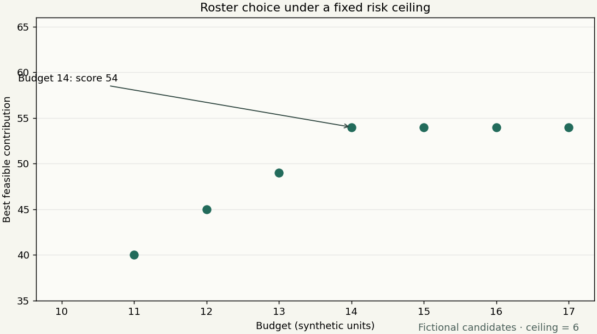

# Sports Franchise Optimization

A reproducible roster selection example that shows how a budget, role requirements, and a risk ceiling constrain player acquisition.



## Approach

- Select one guard, one wing, and one post from a small fictional roster pool.
- Add the candidates' costs and risk scores, reject infeasible rosters, and rank the rest by additive contribution.
- Compare the best feasible value across budgets. The solver enumerates combinations exactly for the included small pool.

**Stack** · Python standard library for optimization and tests. Matplotlib for the chart.

## Layout

- [optimizer.py](optimizer.py) contains the fixture and solver.
- [test_optimizer.py](test_optimizer.py) checks ranking and constraints.
- [render_chart.py](render_chart.py) redraws the public chart.

## Run locally

```sh
python optimizer.py
python -m unittest -v
python -m pip install matplotlib
python render_chart.py
```

## Scope and limits

This is an independently prepared synthetic example of one team modeling project's roster-portfolio idea. The original paper also treats franchise dynamics, pricing, and expansion. This demo omits those models and uses no original datasets or athlete records. Exhaustive enumeration is practical for the small pool here. Its results describe fictional inputs and carry no real player or franchise recommendation.
