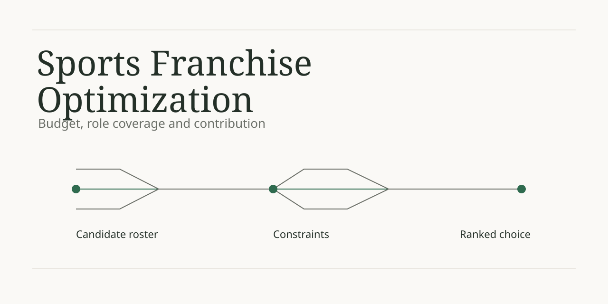
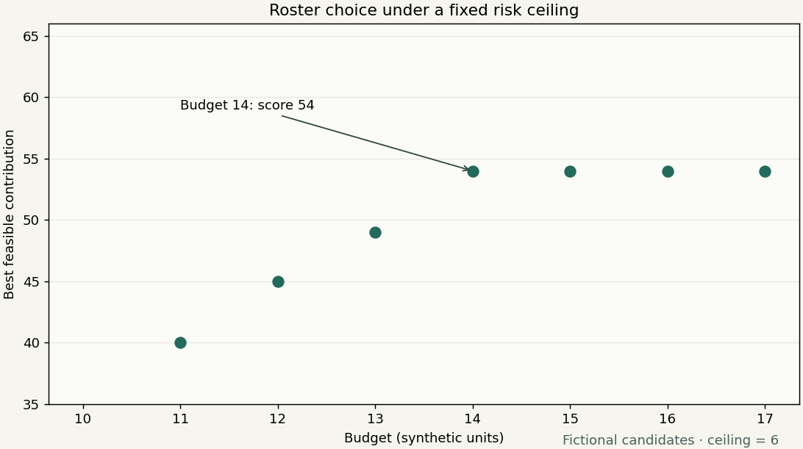

<picture>
  <source media="(prefers-color-scheme: dark)" srcset="docs/cover-dark.svg" />
  <source media="(prefers-color-scheme: light)" srcset="docs/cover-light.svg" />
  
</picture>

# 球队阵容优化

在预算、位置覆盖和风险限制下，选出贡献最高的可行阵容。

[查看演示](#demo) · [English](README.md) · [](https://github.com/Daniel-24-life/sports-franchise-optimization/actions/workflows/ci.yml) · [MIT](LICENSE) · Python 3.11+

## Demo



## 要解决的问题

阵容选择同时受到预算、角色和风险限制。候选人名义贡献高，组合后仍需核对可行性。

## 实现

- 枚举小规模候选组合。
- 分别检查预算、位置和风险约束。
- 绘制预算变化下的最优可行得分。

## 工作流程


## 快速运行

```sh
python optimizer.py
python -m pip install matplotlib
python render_chart.py
```

## 测试

实测 **3 项通过**。[通过的 GitHub Actions 运行](https://github.com/Daniel-24-life/sports-franchise-optimization/actions/runs/45105908472)。

```sh
python -m unittest -v
```

## 仓库目录

| 路径 | 内容 |
| --- | --- |
| [`optimizer.py`](optimizer.py) | Candidate fixture and exact solver |
| [`test_optimizer.py`](test_optimizer.py) | Feasibility and ranking tests |
| [`render_chart.py`](render_chart.py) | Budget trade-off chart |

<sub>结果来自公开球员样例及指定约束，可用于复核优化过程。</sub>
